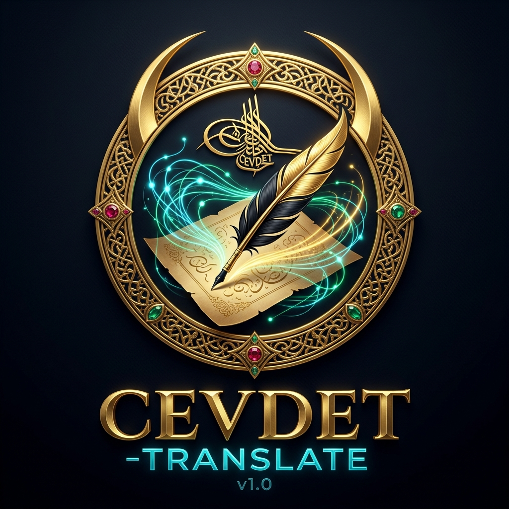

<div align="center">



# Cevdet-Translate 📜✨
### Matbu Osmanlıca Belgeler İçin Uçtan Uca Yapay Zekâ Okuma ve Çeviri Platformu

[](https://github.com/kycn-creator/Cevdet-Translate)
[](LICENSE)
[](https://python.org)
[](https://fastapi.tiangolo.com)
[](https://huggingface.co/microsoft/trocr-base-stage1)
[-brightgreen?style=flat-square)](https://huggingface.co/Qwen/Qwen2.5-3B-Instruct)

</div>

---

## 🏛️ Vizyon ve İsim Mirası

**Cevdet-Translate**, Osmanlı Devleti'nin büyük tarihçisi, hukukçusu (*Mecelle*) ve Türkçenin ilk derli toplu modern dilbilgisi eseri olan *Kavaid-i Osmaniyye*'nin müellifi **Ahmet Cevdet Paşa'nın (1822–1895)** ilmi mirasını modern üretken yapay zekâ teknolojileriyle buluşturmak amacıyla geliştirilmiştir.

Sistem iki aşamalı hibrit bir derin öğrenme mimarisinden oluşur:
1. **Göz (OCR):** Matbu Osmanlıca gazete, dergi ve kitap sayfalarını yatay aynalama (horizontal mirroring) tekniğiyle satır satır okuyan özel `microsoft/trocr-base-stage1` modeli.
2. **Beyin (Çeviri & Anlamlandırma):** 17.066 tarihî çeviri kaydı ve 9.965 maddelik sözlükle eğitilmiş `Qwen2.5-3B-Instruct` 4-bit NF4 QLoRA modeli.

---

## 🏗️ Mimari Şema

```
                             [Matbu Osmanlıca Belge]
                                        │
                                        ▼
                  ┌───────────────────────────────────────────┐
                  │   OpenCV Akıllı Satır Dilimleyici         │
                  │   (Yatay Projeksiyon + Morfolojik Filtre) │
                  └─────────────────────┬─────────────────────┘
                                        │  Satır Görselleri (satir_*.jpg)
                                        ▼
                  ┌───────────────────────────────────────────┐
                  │   FAZ 2: "GÖZ" (TrOCR OCR Modeli)         │
                  │   • ViT Encoder + Hazır TrOCR Decoder    │
                  │   • Yatay Aynalama (Mirroring) Hizalaması │
                  │   • 225.7M Parametre                      │
                  │   • Harf Doğruluğu: %87.83 (CER: %12.17)  │
                  └─────────────────────┬─────────────────────┘
                                        │  Latin Transkripsiyon
                                        ▼
                  ┌───────────────────────────────────────────┐
                  │   FAZ 3: "BEYİN" (Qwen-2.5 QLoRA)         │
                  │   • Qwen2.5-3B-Instruct (4-Bit NF4 LoRA)  │
                  │   • 17.066 Eğitim / 897 Doğrulama Kaydı   │
                  │   • 9.965 Maddelik Tarih & Dil Sözlüğü    │
                  │   • Doğrulama Token Doğruluğu: %85.02     │
                  └─────────────────────┬─────────────────────┘
                                        │
                                        ▼
                  [Kusursuz Günümüz Modern Türkçesi Çevirisi]
```

---

## 🚀 Başarı Metrikleri

| Bileşen | Mimari / Yöntem | Doğruluk | Hata / Kayıp (Loss) |
| :--- | :--- | :---: | :---: |
| **Göz (OCR)** | `microsoft/trocr-base-stage1` + Yatay Aynalama | **%87.83 Harf Doğruluğu** | CER: %12.17 &bull; Eval Loss: 0.6524 |
| **Beyin (Çeviri)** | `Qwen2.5-3B-Instruct` (4-Bit NF4 QLoRA) | **%85.02 Token Doğruluğu** | Eval Loss: 0.7590 &bull; Train Loss: 0.6784 |

---

## 💻 Hızlı Başlangıç

### 1. Depoyu Klonlayın
```bash
git clone https://github.com/kycn-creator/Cevdet-Translate.git
cd Cevdet-Translate
```

### 2. Sanal Ortamı Kurun ve Bağımlılıkları Yükleyin
```bash
python -m venv venv
.\venv\Scripts\activate

pip install -r requirements.txt
```

### 3. Web Arayüzünü Başlatın
```bash
python app.py
```

Tarayıcınızdan açın:
👉 **`http://localhost:8000`**

---

## 🖥️ Arayüz Özellikleri (v1.0.0)

* **1. Görselden Oku ve Çevir:** Matbu Osmanlıca gazete/sayfa görselini sürükleyip bırakın veya `Ctrl + V` ile panodan yapıştırın. Sistem satırları tespit eder, okur ve günümüz Türkçesine aktarır.
* **2. Metin Çevirisi:** Hazır transkripsiyon veya eski Türkçe metinleri doğrudan günümüz Türkçesine çevirin.
* **3. Akıllı Osmanlıca Sözlük:** 9.965 maddelik sözlük tahlili ve yapay zekâ anlamlandırması.
* **Hızlı Test Galerisi:** Modelin eğitimde hiç görmediği doğrulama satırlarını tek tıkla canlı deneyin.

---

## 📂 Dizin Yapısı

```
├── app.py                         # Ana uygulama başlatıcı (Cevdet-Translate v1.0)
├── capa_arayuz.py                 # FastAPI + Uvicorn modern web arayüzü ve API
├── assets/
│   ├── logo.svg                   # Vektörel Cevdet-Translate logosu
│   └── logo.png                   # Yüksek çözünürlüklü logo görseli
├── osmanlica_turkce_sozluk.json   # 9.965 maddelik Osmanlıca-Türkçe sözlük
├── sentetik_veri_uretimi.py       # 8.000 satırlık sentetik veri üretim betiği
├── veri_birlestirme.py            # Train / Validation veri seti bölücü
├── goz_ocr_egitimi.py             # TrOCR OCR eğitim kodu
├── beyin_lora_egitimi.py          # Qwen-2.5 QLoRA eğitim kodu
├── beyin_train.jsonl              # Beyin eğitim seti (17.066 kayıt)
├── beyin_val.jsonl                # Beyin doğrulama seti (897 kayıt)
├── Goz_Egitim_Seti/               # Göz eğitim seti (8.016 satır görseli ve jsonl)
├── requirements.txt               # Gerekli Python bağımlılıkları
├── LICENSE                        # MIT Lisansı
└── .gitignore                     # Git tarafından göz ardı edilecek dosyalar
```

---

## ⚖️ Lisans

Bu proje [MIT Lisansı](LICENSE) kapsamında açık kaynak olarak paylaşılmıştır. Detaylar için `LICENSE` dosyasına bakabilirsiniz.
